[Skip to content](#main)

[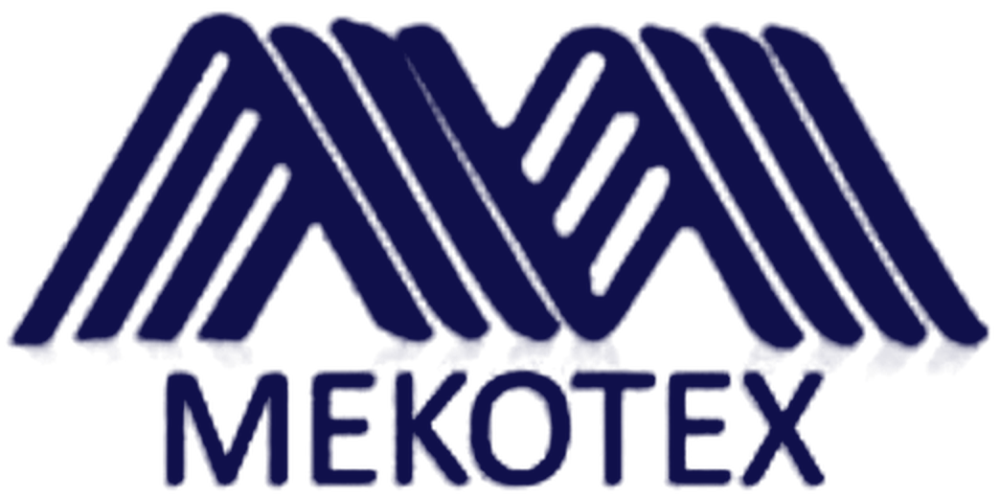](#home)

- [Home](#home)
- - [About Us](#about)
  - [Company History](#history)
  - [CEO's Message](#ceo)
  - [Vision & Mission](#vision)
- [Capabilities](#capabilities)
- [Products](#products)
- [Sustainability](#sustainability)
- [Certifications](#certifications)
- [Gallery](#gallery)
- [Videos](#videos)
- [Contact](#contact)

[Contact Us](#contact)

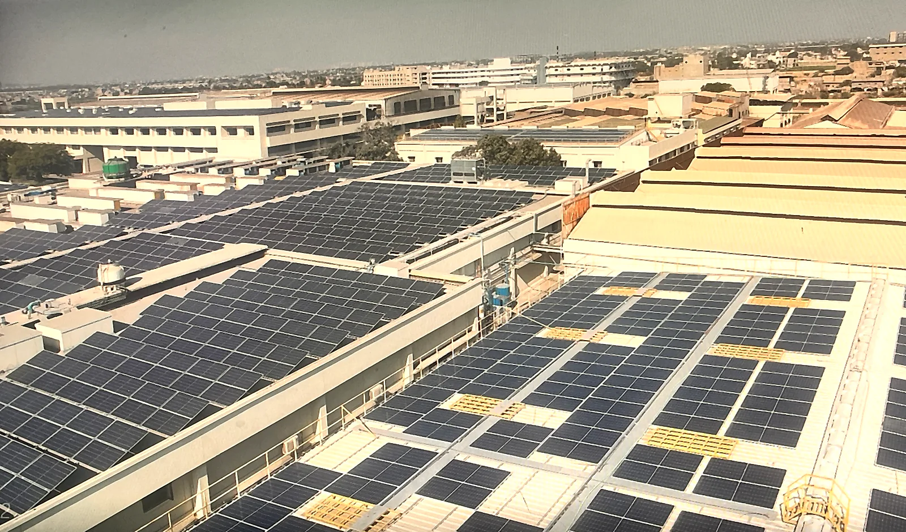

[Scroll](#lf-stats)

Innovation · Quality · Sustainability

# MEKOTEX Textile *Excellence*

A Vertically Integrated Textile Manufacturing & Export Company

Mekotex (PVT.) LIMITED*|*Established in 1991*|*Karachi, Pakistan

[Explore Our Company](#about) [Our Capabilities](#capabilities) [View Company Videos](#videos) [Contact Us](#contact)

Figures as stated by Mekotex. Select a figure for detail.

Who we are

## A manufacturing partner built on integration.

Mekotex's textile business dates back to 1971, and the company was established in 1991. The site on the Main National Highway in Landhi, Karachi, brings every stage of production together, from raw cotton to packed export cartons.

Integration lets buyers trace each programme across spinning, weaving, processing, printing, stitching and packing within one organisation, with consistent quality control from fibre to carton.

[Discover More](#about)[About Mekotex](#about)[Our history](#history)

[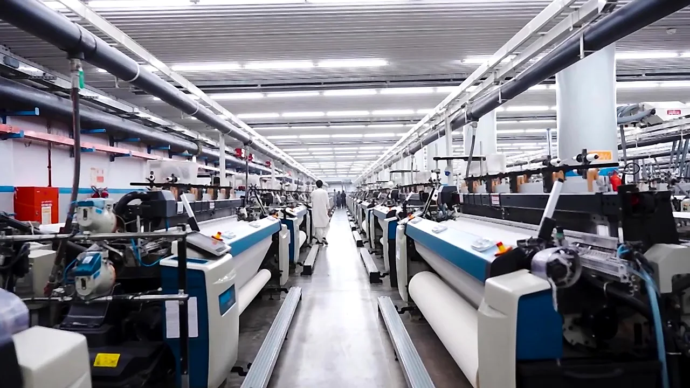Weaving shed](#capabilities)

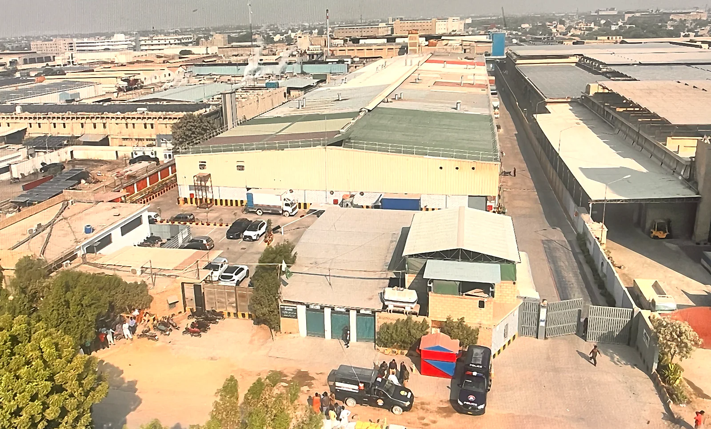

Company profile

## One vertically integrated textile manufacturer and exporter.

[Read our story](#about)

Manufacturing capabilities

## Ten disciplines, one standard.

[All capabilities](#capabilities)

Manufacturing capabilities

## Eleven stages, one supply chain.

Products

## Six product categories for the global home.

[All products & services](#products)

Product collections

## Explore each collection.

Inside Mekotex

## The facility, as it operates.

[Full photo gallery](#gallery)

Factory & infrastructure

## One secured campus on the Main National Highway.

[Site photographs](#gallery)

Quality control

## Every piece is inspected before it is packed.

[Certifications & standards](#certifications)[Checking & inspection photographs](#gallery)

Company videos

## See Mekotex in motion.

[All videos](#videos)

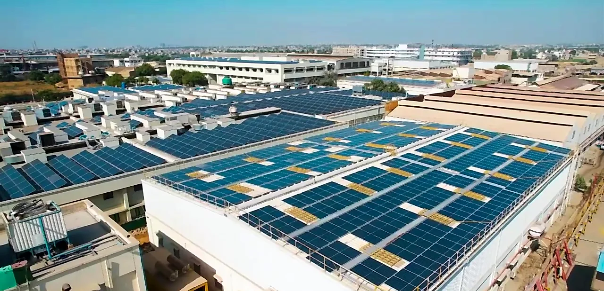

Sustainability

## Cleaner energy, treated water, responsible processing.

- Rooftop solar generation across production roofs
- Effluent Treatment Plant and Reverse Osmosis plant
- Ozone wash technology, heat recovery and energy conservation

[Our sustainability programme](#sustainability)

Certifications

## Standards our buyers rely on.

[Standards and scope](#certifications)

Corporate gallery

## Mekotex in pictures.

[Open the full gallery](#gallery)

Corporate videos

## Watch Mekotex at work.

[Video library](#videos)

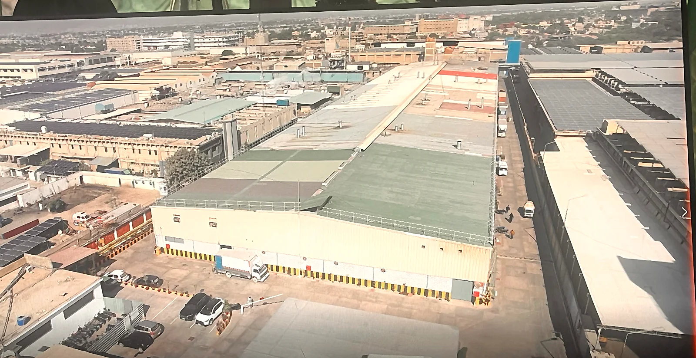


Virtual Factory Experience

## Coming Soon

An interactive 3D tour of the Mekotex manufacturing campus is in development. Until it launches, explore the facility through our photo gallery and company videos.

[Photo gallery](#gallery)[Company videos](#videos)

Contact

## Start a programme with Mekotex.

Tell us about your product, quantities and timeline, and we will prepare your enquiry for the Mekotex team.

Factory & head office

495-DEH Main National Highway\
Landhi, Karachi, Pakistan

Online

[mekotex.com](https://mekotex.com/)

[Full contact page](#contact)[Request certificates](#certifications)

### Business enquiry

NameCompany

EmailCountry

Product interest Message

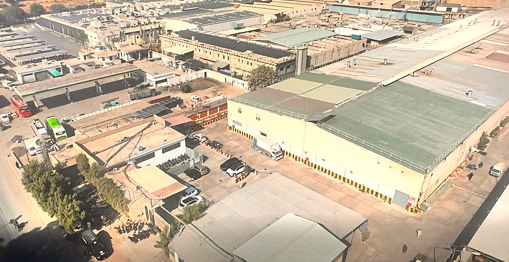

About Us

# Five decades of textile craft in Karachi.

Our story

## Rooted in textiles since 1971.

Mekotex (Pvt.) Limited is a Karachi-based, vertically integrated textile manufacturer and exporter specialising in home textiles, denim, fabrics and digital printing. Its textile business began in 1971, and Mekotex was established as a company in 1991.

Today Mekotex runs integrated manufacturing from ginning and spinning to stitching and packing, and supplies bedding, denim, fabrics and kitchen, window and bath textiles to buyers abroad.

[Company history](#history)[CEO's message](#ceo)[Vision & mission](#vision)

**1971**Textile operations begin

**1991**Mekotex (Pvt.) Limited established

**11**In-house manufacturing stages

**6**International certifications & standards


Our site

## 495-DEH Main National Highway, Landhi.

Long-span production sheds, a finished-goods warehouse, utilities and rooftop solar sit together on one secured campus with direct access to the Main National Highway and onward routes to Karachi's ports.

Every vehicle and visitor enters through a controlled security gate, and internal roads link the receiving, production and dispatch areas.

[View site photographs](#gallery)

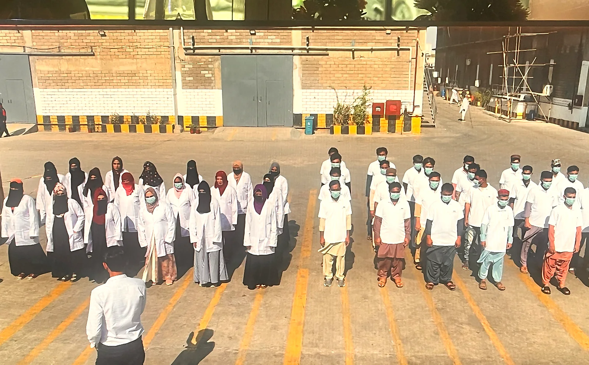

Our people

## Teams who know the work.

Operators, technicians, inspectors and merchandisers run every stage of production, from the stitching lines to final checking and packing.

[Our people in pictures](#gallery)

At a glance

## From the gate to the warehouse.

[Open the gallery](#gallery)

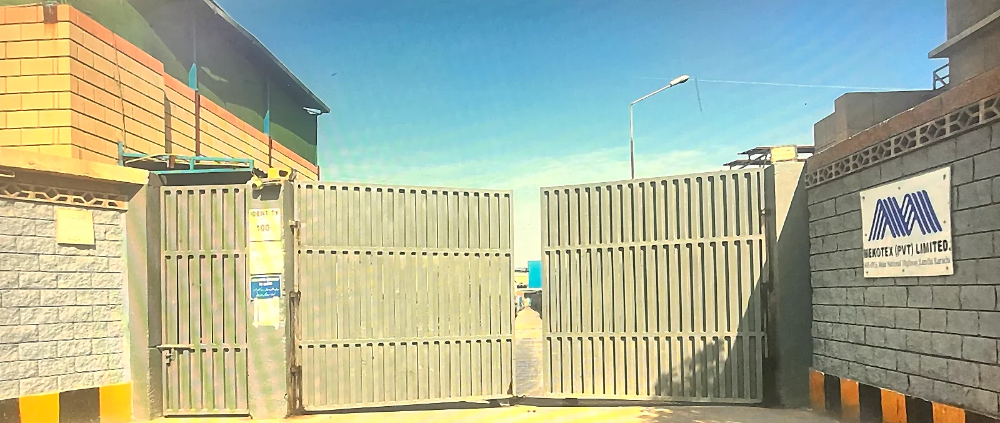

Company History

# A family of textile businesses since 1971.

From its first textile operations in 1971 to the founding of Mekotex (Pvt.) Limited in 1991, the business has grown into an integrated manufacturer serving international home-textile programmes.

1. **1971**

   ### Textile operations begin

   The group's textile business starts in Karachi, building the experience in fibre, yarn and fabric that Mekotex is founded on.
2. **1991**

   ### Mekotex (Pvt.) Limited is established

   Mekotex is incorporated as a private limited company in Karachi, Pakistan, focused on textile manufacturing and export.
3. **Growth**

   ### Integration across the value chain

   Capabilities are brought under one organisation: ginning, spinning, weaving, denim, dyeing, processing, digital printing, finishing, cutting, stitching and packing.
4. **Standards**

   ### International certification

   The company works to management-system, product and sourcing standards including ISO 14001, OEKO-TEX® STeP and Made in Green, GOTS, Better Cotton and Textile Exchange standards.
5. **Today**

   ### Landhi manufacturing campus

   A secured campus at 495-DEH Main National Highway, Landhi, with stitching halls, a finished-goods warehouse, utilities and rooftop solar generation.

Dated milestones are those confirmed by Mekotex. Further dates can be added when the company provides them.

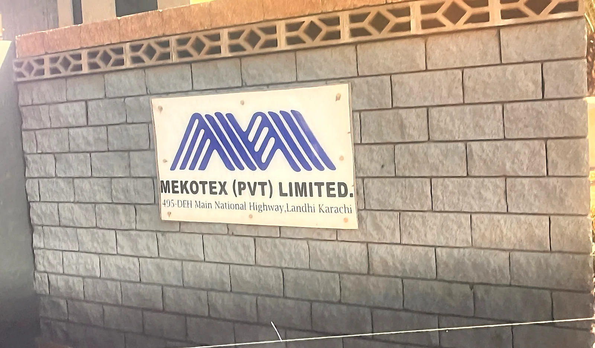

Heritage

## The same name on the gate for over three decades.

The Mekotex mark, a stylised M of parallel lines, stands at the main gate of the Landhi campus beside the company's registered address.

[About Mekotex today](#about)

CEO's Message

# A message from our Chief Executive.

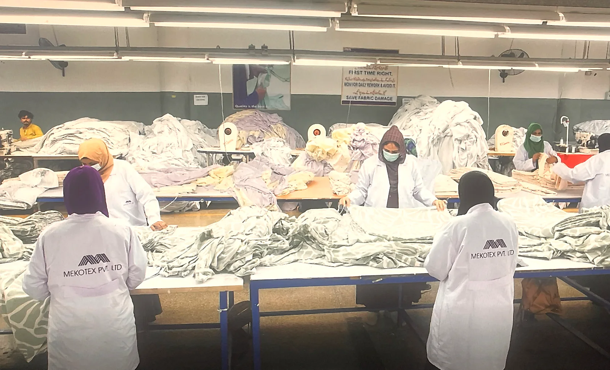

Loading…

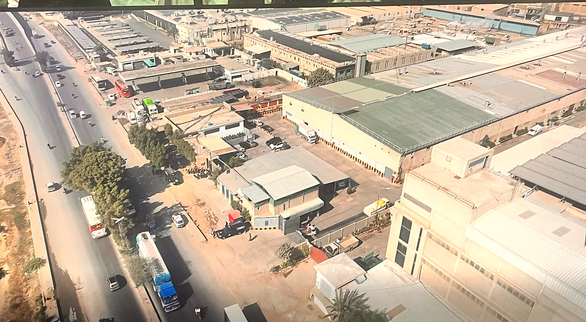

Vision & Mission

# What we work towards.

Loading…

How we work

## The principles behind our operations.

### Integration

Eleven manufacturing stages under one organisation give buyers control of quality, lead time and traceability.

### Quality

Every piece is inspected on dedicated checking tables before it is packed for export.

### Responsibility

Rooftop solar, water treatment and certified processes reduce the footprint of production.

### People

Skilled teams across spinning, stitching, checking and packing deliver every programme.

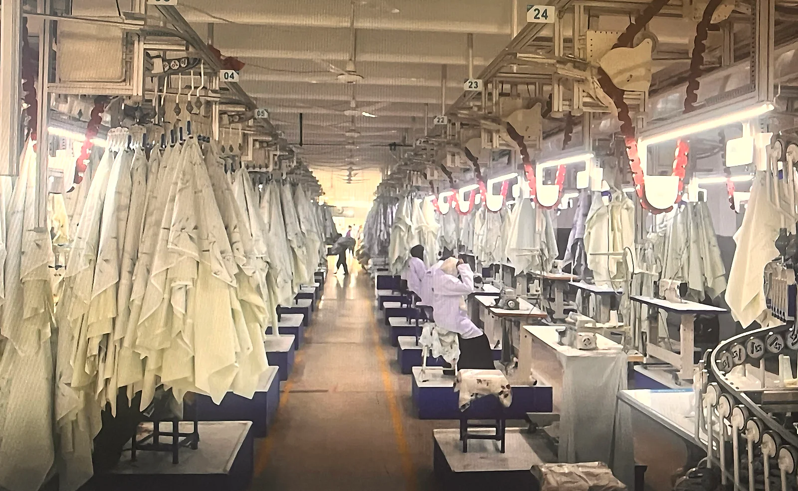

Manufacturing Capabilities

# Every stage, in-house.

With ginning through to packing under one organisation, Mekotex controls quality, lead time and traceability at every step of a programme.

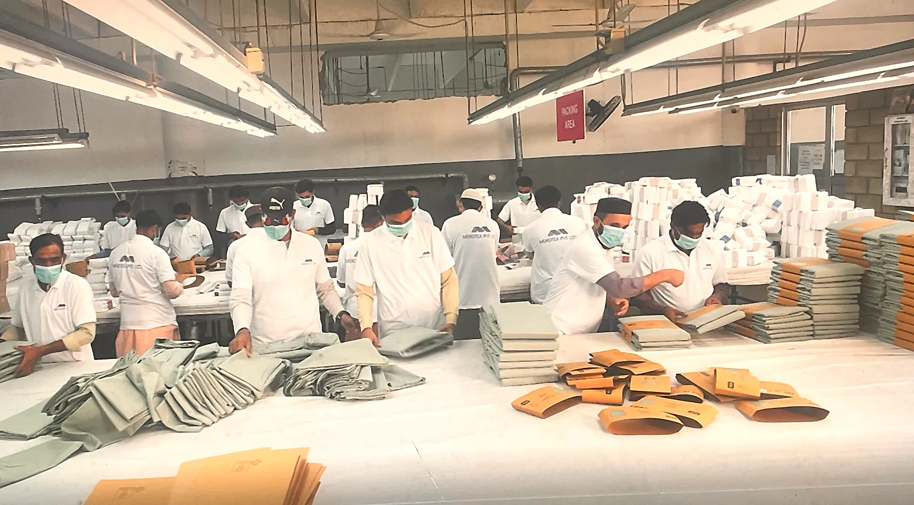

Products & Services

# Home textiles and fabrics for global programmes.

Services

## From development to dispatch.

- **Fabric development**Yarn, construction and finish developed to the programme brief.
- **Digital printing**Direct printing for short runs, sampling and multiple colourways.
- **Make-up**Cutting, stitching and checking in dedicated garment units.
- **Packing to specification**Retail packs, inserts, labels and carton marks to buyer instructions.
- **Export logistics**Palletised finished-goods storage and dispatch by road to port.

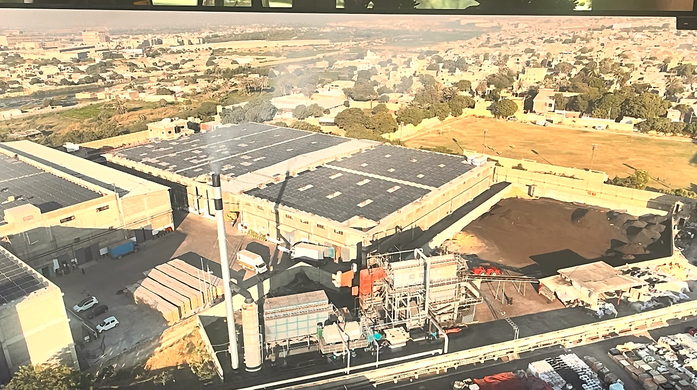

Sustainability

# Manufacturing with a lighter footprint.

Textile processing uses a great deal of water and energy. Mekotex invests in systems that reduce consumption, treat discharge and recover heat.

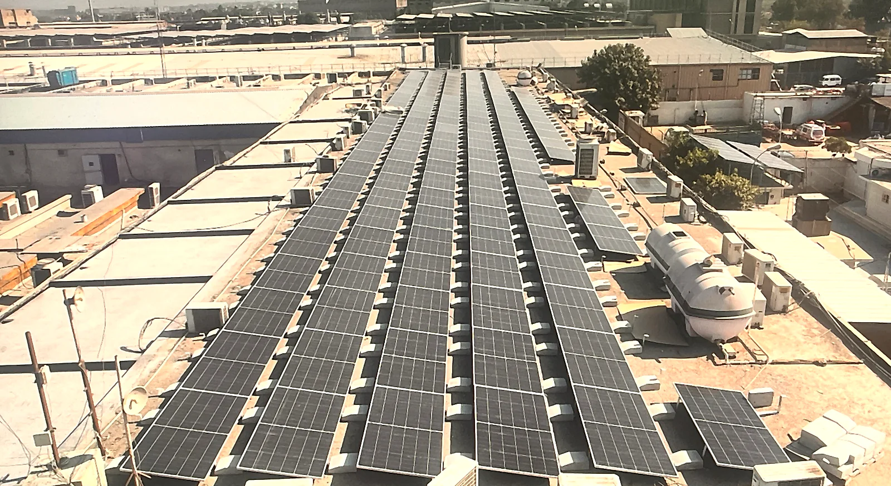

Environmental initiatives

## Visible on the roofs.

Solar arrays cover large areas of the site's production roofs, as the drone footage shows.

[Solar installation photographs](#gallery)

Certifications

# Standards our buyers rely on.

Mekotex references the following management-system, product and sourcing standards. Certificate scope, licence numbers and validity dates are available on request for each programme.

[Request certificates](#contact)

Photo Gallery

# Inside the Mekotex campus.

Photographs from Mekotex site and drone footage, organised by area.

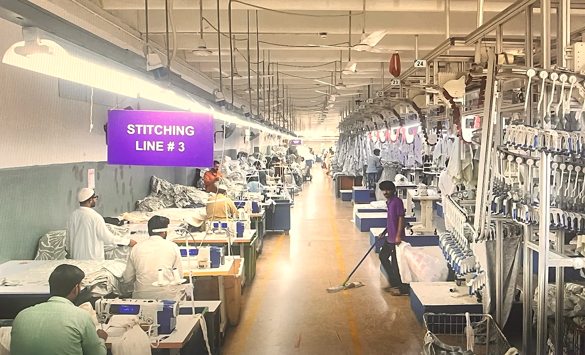

Company Videos

# Mekotex on film.

Corporate films, factory footage and product videos from Mekotex.

Search videos

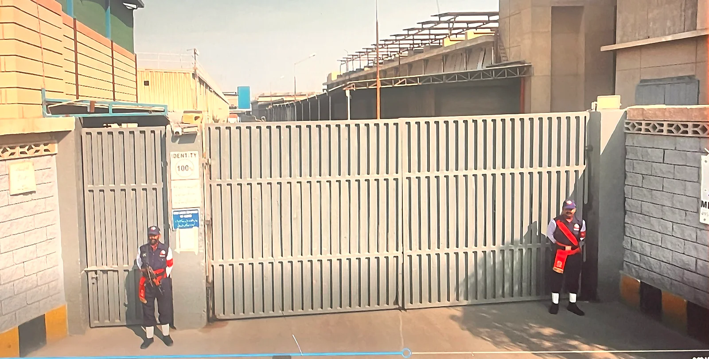

Contact

# Start a programme with Mekotex.

### Factory & head office

Mekotex (Pvt.) Limited\
495-DEH Main National Highway\
Landhi, Karachi\
Pakistan

[Open in Google Maps](https://www.google.com/maps/search/?api=1&query=Mekotex+495+Deh+Landhi+Main+National+Highway+Karachi)

### Online

- [mekotex.com](https://mekotex.com/)
- [LinkedIn](https://pk.linkedin.com/company/mekotex)
- [Instagram](https://www.instagram.com/mekotexpvtltd/)
- [YouTube](https://www.youtube.com/channel/UCt-bepwmuKlIHClFqSLR6jA)

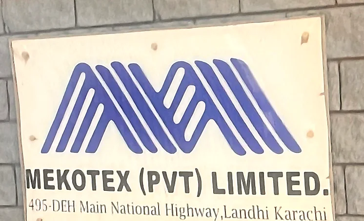

### Programme enquiry

NameCompany

EmailCountry

Interested in Message

**Your enquiry is ready.**

```

```

Open in email app[Message on LinkedIn](https://pk.linkedin.com/company/mekotex)

Loading…


Mekotex (Pvt.) Limited\
495-DEH Main National Highway, Landhi, Karachi, Pakistan

[About Us](#about)[Company History](#history)[CEO's Message](#ceo)[Vision & Mission](#vision)[Capabilities](#capabilities)[Products & Services](#products)[Sustainability](#sustainability)[Certifications](#certifications)[Photo Gallery](#gallery)[Videos](#videos)[Contact](#contact)

[LinkedIn](https://pk.linkedin.com/company/mekotex)[Instagram](https://www.instagram.com/mekotexpvtltd/)[YouTube](https://www.youtube.com/channel/UCt-bepwmuKlIHClFqSLR6jA)

© 2026 Mekotex (Pvt.) Limited. All rights reserved.Facility imagery: Mekotex site and drone footage.[Admin login](#admin)

[Powered by Jarries.com](https://jarries.com)